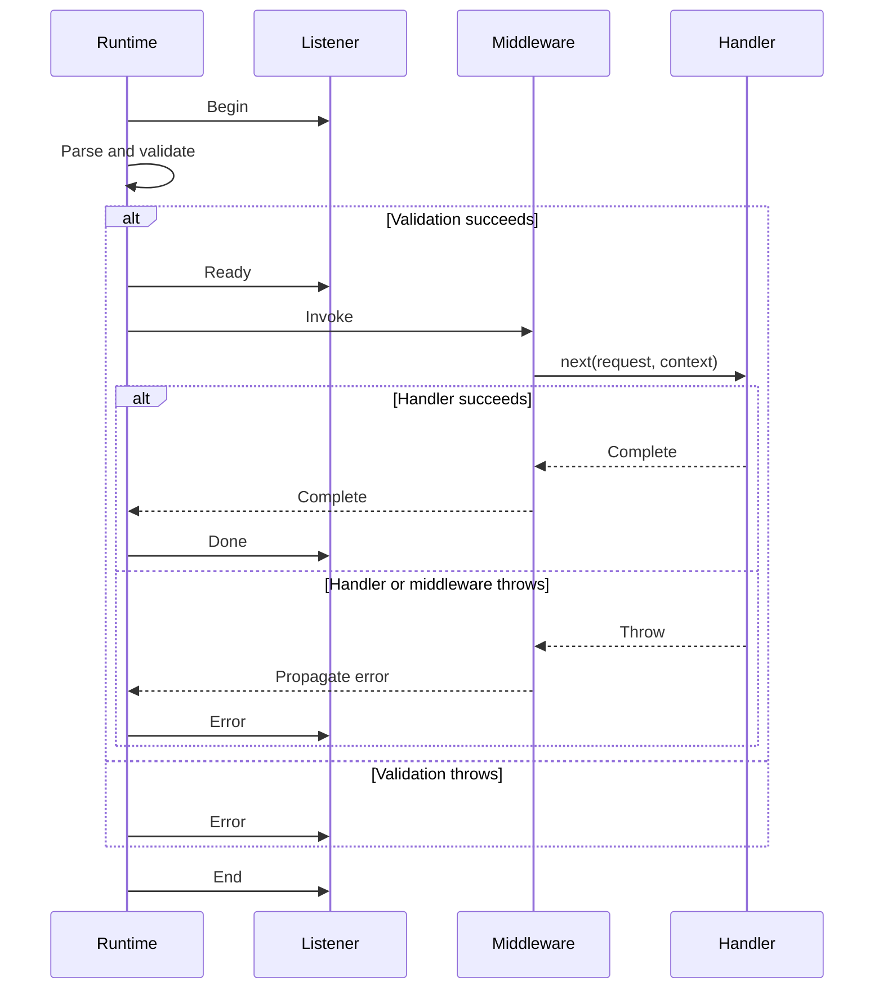

# EZ4: Listeners

Listeners observe the lifecycle of a contract execution. They receive typed events and the same service context available to the contract's handler, but do not own handler execution.

## Listener implementation

A listener receives a contract-specific service event and context:

```ts
export function myListener(event: Queue.ServiceEvent<MyMessage>, { serviceClient }: Service.Context<MyQueue>) {
  serviceClient.do_something();

  switch (event.type) {
    case ServiceEventType.Begin:
      // Execution started.
      break;

    case ServiceEventType.Ready:
      // Validation and transformation completed.
      break;

    case ServiceEventType.Done:
      // Handler completed successfully.
      break;

    case ServiceEventType.Timeout:
      // Execution is nearing termination.
      break;

    case ServiceEventType.Error:
      // Validation or handler execution failed.
      break;

    case ServiceEventType.End:
      // Execution finished.
      break;
  }
}
```

Destructure every linked service needed by the listener from its context. These bindings are included in the bundle's context references, so a service required by the listener is retained even when the user handler does not destructure it. The same rule applies to [middleware](./middlewares.md) factory context.

Attach a listener through the contract's `listener` property.

```ts
listener: typeof myListener;
```

## Lifecycle events

Listener event types are shared across contracts:

- **Begin** - execution started and the initial request is available.
- **Ready** - validation and transformation completed and the handler is ready to run.
- **Done** - the handler completed successfully.
- **Timeout** - the execution is nearing its termination deadline.
- **Error** - validation, middleware, or handler execution failed.
- **End** - execution finished, regardless of its outcome.

Events contain the partially prepared request available at that lifecycle stage.



## Failure behavior

- `Begin` and `Ready` are fail-fast. Listener errors stop the current execution.
- `Done`, `Timeout`, `Error`, and `End` are best-effort. Listener errors are logged without replacing the execution outcome.

## Listeners and middleware

Listeners observe execution; middleware participates in handler execution. Use middleware to wrap or short-circuit a user handler. Use listeners for lifecycle logging, metrics, and tracing annotations.

Because listeners run around validation and handler execution, they can observe failures that happen before middleware is reached.

## What's next

- [Quick start](./quick-start.md)
- [Configuration](./configuration.md)
- [Deployment overview](./deployment.md)
- [Contracts overview](./contracts.md)
- [Middlewares overview](./middlewares.md)
- [Architecture overview](./architecture.md)
- [Philosophy](./philosophy.md)

## License

MIT License
