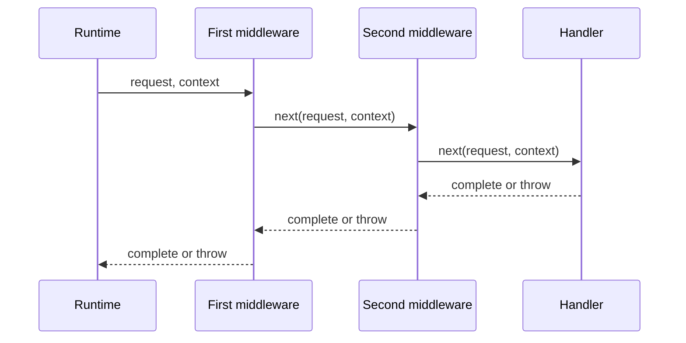
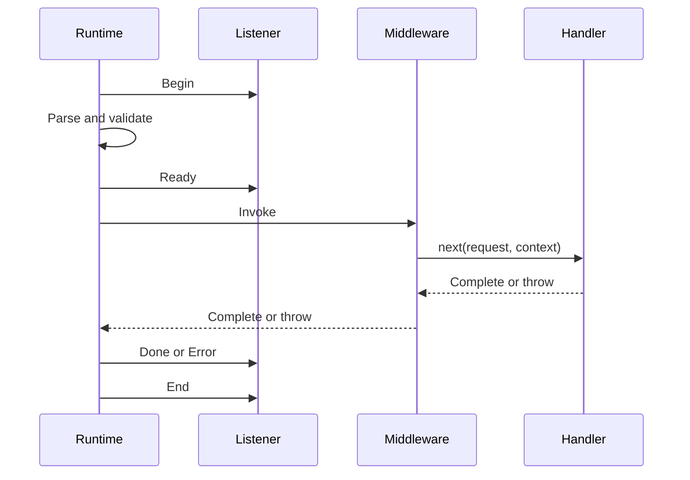

# EZ4: Middlewares

Middleware wraps a user handler while preserving the handler's request and context contract. Contracts that support middleware expose an ordered `middlewares` tuple.

## Implementation

A middleware receives the next handler and service context, then returns another handler:

```ts
export function traceHandler(next: Queue.Handler<MyMessage>, { serviceClient }: Service.Context<MyQueue>): Queue.Handler<MyMessage> {
  serviceClient.do_something();

  return async (request, context) => {
    try {
      return await next(request, context);
    } finally {
      // Record handler execution.
    }
  };
}
```

Attach middleware by type:

```ts
middlewares: [typeof traceHandler, typeof collectMetrics];
```

## Order

Middleware is composed in declaration order. The first middleware is outermost:



Calling `next(request, context)` continues the chain with the same request and context. Middleware may deliberately replace those values before continuing. The context passed to the middleware factory is the same linked service context passed to the returned handler.

Destructure every linked service needed by a middleware from its factory context. These bindings are included in the bundle's context references, so a service required by middleware is retained even when the user handler does not destructure it. The same rule applies to [listeners](./listeners.md): destructuring a linked service in a listener guarantees it remains available in the handler bundle.

## Short-circuiting

Middleware owns whether the next handler runs. Returning without calling `next` short-circuits the remaining middleware and the user handler.

```ts
export function rejectDuplicates(next: Queue.Handler<MyMessage>, { duplicateStore }: Service.Context<MyQueue>): Queue.Handler<MyMessage> {
  return async (request, context) => {
    if (await isDuplicate(request.message, duplicateStore)) {
      return;
    }

    await next(request, context);
  };
}
```

The result of a short-circuited handler depends on the contract's normal successful-completion semantics.

## Errors

Middleware runs after contract validation and transformation. Middleware errors are handled like user-handler errors by the surrounding contract.

Use middleware to wrap user-handler execution. Use a lifecycle listener to observe earlier failures, such as request parsing or validation, and later lifecycle transitions.



## What's next

- [Quick start](./quick-start.md)
- [Configuration](./configuration.md)
- [Deployment overview](./deployment.md)
- [Contracts overview](./contracts.md)
- [Listeners overview](./listeners.md)
- [Architecture overview](./architecture.md)
- [Philosophy](./philosophy.md)

## License

MIT License
